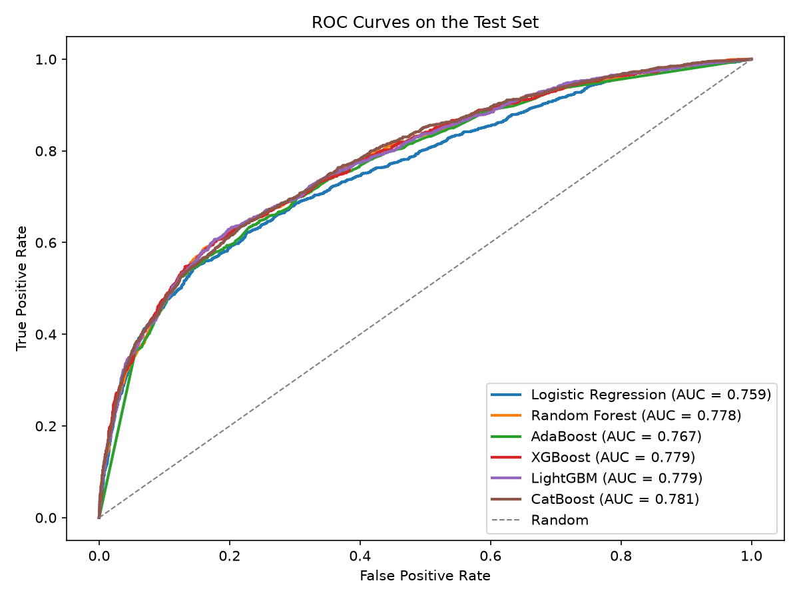
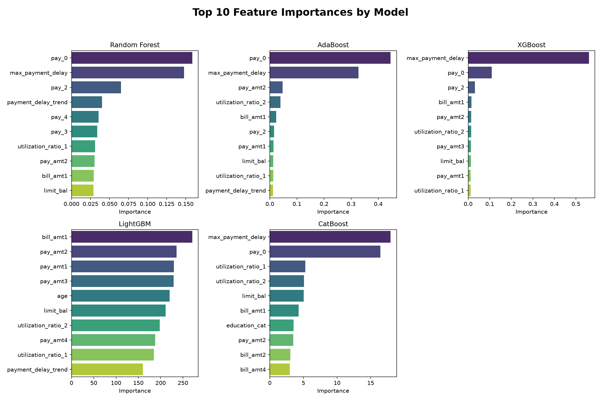

<h1 align="center">Credit Card Default Prediction</h1>

<p align="center">
  Predicting which credit card clients will miss next month's payment, comparing logistic regression with five tree-based ensembles.
</p>

<p align="center">
  
  
  <a href="LICENSE"></a>
</p>



## Overview

The analysis uses 30,000 credit card clients in Taiwan (April to September 2005) to predict default in the following month. About 22% of clients default, so the project focuses on handling class imbalance, scoring models on F1 rather than accuracy, and checking which features drive the predictions.

All of the work is in [`notebooks/default_prediction.ipynb`](notebooks/default_prediction.ipynb).

## Approach

- **Feature engineering.** Grouped unknown education codes, treated repayment status as categorical, and added three behavior features: the maximum payment delay, the trend in payment delays from April to September, and monthly credit utilization (bill amount / credit limit).
- **Class imbalance.** SMOTE inside the logistic regression pipeline, so it only oversamples the training folds during cross-validation. Class weights for the tree-based models.
- **Models.** Logistic Regression, Random Forest, AdaBoost, XGBoost, LightGBM and CatBoost, each tuned with `RandomizedSearchCV` (15 candidates, stratified 5-fold CV, F1 scoring).
- **Evaluation.** Accuracy, precision, recall, F1 and ROC AUC on a held-out 20% test set, plus confusion matrices, ROC curves and feature importances.

## Results

Test set, default 0.5 threshold:

| Model | Accuracy | Precision | Recall | F1 | ROC AUC |
|-------|---------:|----------:|-------:|---:|--------:|
| Logistic Regression | 0.755 | 0.457 | 0.581 | 0.512 | 0.759 |
| Random Forest | 0.771 | 0.486 | 0.607 | **0.540** | 0.778 |
| AdaBoost | 0.750 | 0.451 | 0.599 | 0.515 | 0.767 |
| XGBoost | **0.800** | **0.552** | 0.515 | 0.533 | 0.779 |
| LightGBM | 0.755 | 0.460 | **0.636** | 0.534 | 0.779 |
| CatBoost | 0.752 | 0.456 | 0.629 | 0.529 | **0.781** |

- Every model beats a random baseline (F1 about 0.22) by a wide margin. Random Forest has the best F1 and CatBoost the best ROC AUC.
- The models are close once each one handles the imbalance. They differ mostly in where they land on the precision/recall trade-off, so tuning the decision threshold is the obvious next step.
- **Recent repayment status (`pay_0`) and maximum payment delay** are the strongest predictors, followed by credit limit, utilization and recent bill and payment amounts. Demographics add little.



## Dataset

[Default of Credit Card Clients](https://archive.ics.uci.edu/dataset/350/default+of+credit+card+clients) from the UCI Machine Learning Repository, also on [Kaggle](https://www.kaggle.com/datasets/uciml/default-of-credit-card-clients-dataset/data).

| Group | Columns |
|-------|---------|
| Demographics | `SEX`, `EDUCATION`, `MARRIAGE`, `AGE` |
| Credit limit | `LIMIT_BAL` (NT dollars) |
| Repayment status | `PAY_0`, `PAY_2` to `PAY_6` (September back to April; -2 no use, -1 paid in full, 0 revolving, 1 to 8 months late) |
| Bill amounts | `BILL_AMT1` to `BILL_AMT6` |
| Payment amounts | `PAY_AMT1` to `PAY_AMT6` |
| Target | `default.payment.next.month` (1 = default) |

## Limitations

- **Default threshold.** All metrics use a 0.5 cutoff. A lender would set the cutoff from the cost of a missed default versus a declined good customer.
- **One random split.** Results come from a single stratified 80/20 split, not a time-based split, so they don't show how the models hold up on later customers.
- **Old, narrow data.** The data covers six months of one Taiwanese bank's clients in 2005, so the results may not carry over to other markets or years.

## Getting started

### Prerequisites

- Python 3.12
- On macOS, the OpenMP runtime for XGBoost and LightGBM: `brew install libomp`

### Installation

```bash
git clone https://github.com/Yahlawat/Credit-Card-Default-Prediction.git
cd Credit-Card-Default-Prediction

python3 -m venv .venv
source .venv/bin/activate

pip install -r requirements.txt
```

### Data

Download `UCI_Credit_Card.csv` from [Kaggle](https://www.kaggle.com/datasets/uciml/default-of-credit-card-clients-dataset/data) and save it as `data/UCI_Credit_Card.csv`. The `data/` folder is ignored by git.

### Run

```bash
jupyter notebook notebooks/default_prediction.ipynb
```

Running the whole notebook takes about 5 minutes on a laptop. Results are reproducible with the fixed random seed (42). Tested with Python 3.12, scikit-learn 1.9, XGBoost 3.4, LightGBM 4.7 and CatBoost 1.2.

## Project structure

```
.
├── notebooks/
│   └── default_prediction.ipynb   # Full analysis
├── data/                          # Dataset (not tracked, see Data above)
├── images/                        # Figures saved by the notebook
├── requirements.txt
├── LICENSE
└── README.md
```

## License

Released under the [MIT License](LICENSE).
